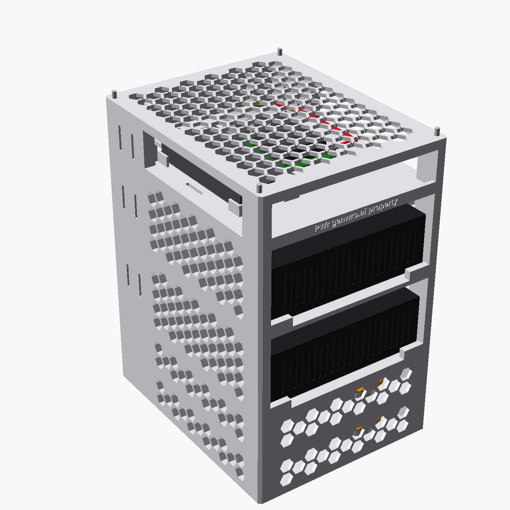
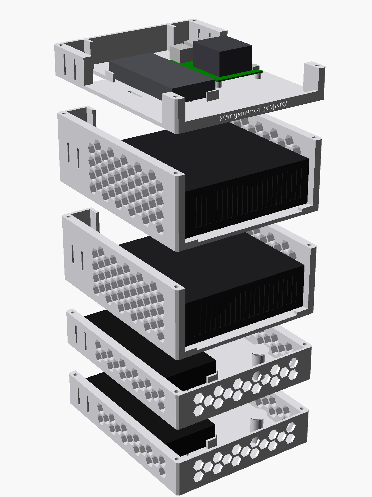
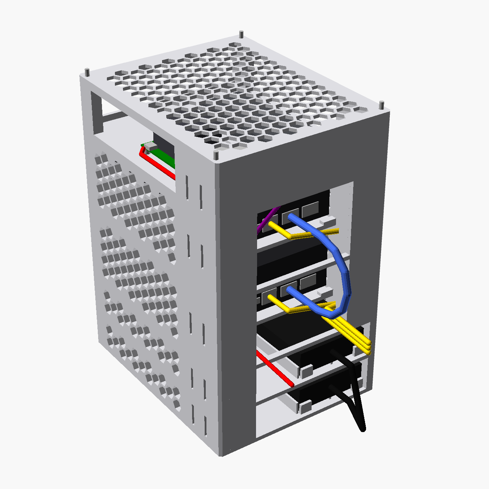
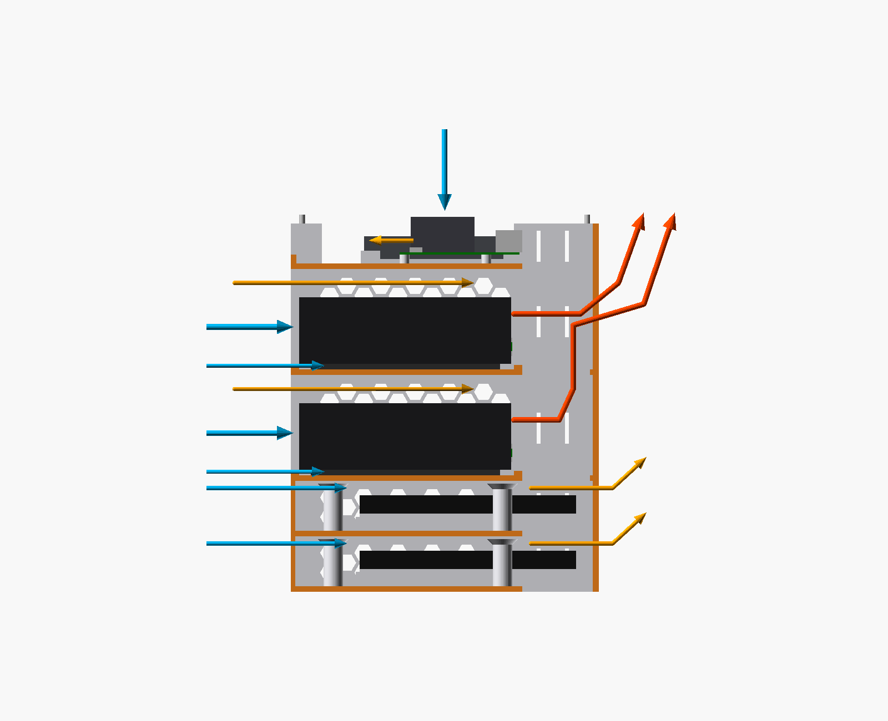

# AI TOP ATOM mini-rack

A 3D-printable desktop rack for:

- 2× **GIGABYTE AI TOP ATOM** (NVIDIA GB10)
- their 2× **Delta ADP-240KB BA** 240 W USB-C power adapters
- 1× **Raspberry Pi 5** with Active Cooler
- 1× **ICY BOX IB-1917M-C32a** M.2 NVMe enclosure

The parts are tuned for a **Bambu Lab P1S** printing in **ASA**. Every part prints without supports.



| Exploded | Rear (cables) | Airflow |
|---|---|---|
|  |  |  |

**Assembled size:** 174 × 218 × 283 mm (W × D × H). Leave **at least 10 cm free behind the rack** for exhaust.

---

## Contents

```
atom_rack.scad    parametric OpenSCAD model (all parts + reference models + renders)
stl/tray.stl      power tray        x2
stl/bay.stl       Atom bay          x2
stl/deck.stl      Pi + SSD deck     x1
stl/lid.stl       honeycomb lid     x1   (already flipped for printing)
renders/          preview images
```

The stack, from bottom to top:

| # | Part | Height | Holds |
|---|---|---|---|
| 1 | tray | 39.3 mm | power brick #1 + spool for its 1.8 m USB-C cable |
| 2 | tray | 39.3 mm | power brick #2 + spool |
| 3 | bay | 75.2 mm | AI TOP ATOM #1 |
| 4 | bay | 75.2 mm | AI TOP ATOM #2 |
| 5 | deck | 32 mm | Raspberry Pi 5 + SSD side by side, front label |
| 6 | lid | 22 mm | vented top cover |

Four M4 threaded rods run through the corner pillars and clamp all six modules together.

---

## Printing on a Bambu Lab P1S

### Material: ASA

Use **Bambu ASA** (about 0.75–1.0 kg for the full set). Avoid PETG and PLA:

| | Bambu ASA | Bambu PETG HF | PLA |
|---|---|---|---|
| Heat deflection (0.45 MPa) | **100 °C** | 69 °C | ~55 °C |
| Margin over the 58 °C brick case | **~40 °C** | ~10 °C | none |

- The power brick's case reaches **58 °C at full load** (ChargerLAB, measured in a 25 °C room).
- The rods keep the frame under constant clamping load, and warm PETG slowly deforms under constant load.
- PETG is only acceptable in a cool room with light workloads. A good compromise is to print the two **trays** in ASA and the rest in PETG.

Datasheets: [Bambu ASA](https://wiki.bambulab.com/filament-acc/abs-asa-pc/6eaf4c432d1d4014a1975e55a55ed00b.pdf), [Bambu PETG HF](https://store.bblcdn.com/s6/default/20423d7f839c4a66b9712508549c68b4/Bambu_PETG_HF_TDS.pdf).

### Before you start

- **Dry the filament** at 80 °C for 8 h if the spool has been open (Bambu recommendation).
- **Plate:** Textured PEI with a thin layer of glue stick.
- **Ventilate the room.** ASA smells while printing; don't print it next to where you sleep.

### Plates

Every part is 174 × 218 mm, so **print one part per plate** (P1S bed: 256 × 256 mm). Import the STL as-is; it's already in the right orientation.

| Plate | File | Qty | Part height | On the bed |
|---|---|---|---|---|
| 1–2 | `stl/tray.stl` | 2 | 39.3 mm | floor down |
| 3–4 | `stl/bay.stl` | 2 | 75.2 mm | floor down |
| 5 | `stl/deck.stl` | 1 | 32 mm | plate down |
| 6 | `stl/lid.stl` | 1 | 22 mm | honeycomb top down (exported flipped) |

**Print one tray first.** It's the quickest part, so use it to check brim, warping and hole fit before the long bay prints.

### Bambu Studio settings

Start from the system presets and change only what's listed:

- **Printer:** Bambu Lab P1S, 0.4 mm nozzle
- **Filament:** Bambu ASA
- **Process:** 0.20 mm Standard @BBL P1S

| Setting | Value | Why |
|---|---|---|
| Wall loops | **4** | rod pillars and 2.4 mm honeycomb struts come out solid |
| Top / bottom shell layers | **5 / 5** | floors and deck double as heat shields |
| Sparse infill | **15–20 % gyroid** | |
| Supports | **Off** | the model is designed support-free |
| Brim | **Outer only, 5 mm** | large, flat ASA parts lift at the corners |
| Seam | Aligned or Back | seam lands on the rear corners |
| Everything else | preset default | |

Why supports aren't needed:

- The hexagons have flat tops, so each one only needs a bridge of about 6.7 mm. ASA handles bridges up to about 40 mm.
- Strap slits, grilles and spool caps are vertical or chamfered at 45°.
- The engraved label is 0.8 mm deep on a vertical face.

### Running the print

1. Close the door and keep the top glass on.
2. **Preheat the chamber.** The P1S has no chamber heater, so heat the bed to 100 °C for about 10 minutes before starting. Bambu suggests a 45–60 °C chamber for ASA.
3. Print.
4. **Let the part cool inside the closed printer** (about 15–20 min) before removing it. Opening the door early is the main cause of warped corners.
5. Remove the brim. Run a 4.5 mm drill through the rod holes if a rod binds.

### Fit-critical features

All of these are adjustable in `atom_rack.scad`.

| Feature | Size | Parameter |
|---|---|---|
| M4 rod holes | Ø 4.5 mm | `rod_d` |
| M4 nut recesses (underside of trays) | 7.4 mm across flats, 4 mm deep | `nut_af`, `nut_h` |
| Pi 5 screw holes | Ø 2.3 mm, for M2.5 thread-forming screws | in `deck()` |
| Clearance around each Atom | 2 mm per side | `clr` |
| Strap slits / slots | 3 × 22 mm | in `strap_slits()` / `deck()` |

---

## Hardware

| Qty | Item | Notes |
|---|---|---|
| 4 | **M4 threaded rod, ~290 mm** | stainless A2; cut to length (OpenSCAD prints the exact value) |
| 4 | M4 hex nut | sit in the recesses under the bottom tray |
| 4 | M4 washer | on top of the lid |
| 4 | M4 acorn (dome) nut | on top of the lid |
| 4 | M2.5 × 6 mm thread-forming screw | fix the Pi 5 to the deck standoffs |
| 1 | Hook-and-loop strap, ≤ 20 mm wide | holds the SSD (threads through the deck) |
| 6–10 | Hook-and-loop cable ties, ≤ 20 mm wide | for the rear raceway strap slits |
| 4 | Adhesive rubber feet, **≥ 6 mm tall** | under the bottom tray; keeps its floor vents open |
| 1 | QSFP112 passive DAC, **0.4–0.5 m** | Atom ↔ Atom 200 GbE link |
| 1 | Raspberry Pi 5 USB-C PSU (27 W) | off-rack |
| 2 | 10GbE patch cables | Atom → your switch |
| 1 | 1 GbE patch cable | Pi → your switch |

The bricks' C5 mains cords and the SSD's 30 cm USB-C cable come in the box.

---

## Assembly

Work from the bottom up: each module drops over the rods onto the one below.

1. **Bottom tray**
   1. Press 4 M4 nuts into the hex recesses underneath. Screw the rods in until each end is flush with the bottom of its nut.
   2. Stick the rubber feet near the corners, clear of the nut recesses and the floor vents.
2. **Brick #1**
   1. Lay the brick on the ribs against the left wall, **mains socket (C6) facing the back**, USB-C cable leaving the front.
   2. Lead the cable forward, then wind it around the two spool posts in the right-hand lane (about 5 turns).
   3. Run the end back into the **right rear raceway**. Plug in the mains cord at the back.
3. **Tray #2 + brick #2**
   1. Drop the second tray over the rods.
   2. Feed brick #1's cable up through the floor cut-out in the right rear corner.
   3. Install brick #2 the same way.
   - Fit each brick **before** stacking the next module: the front grille and rear stops keep it in place, so it can't slide in later.
4. **Bays**
   1. Drop both bays on.
   2. Slide each Atom in from the front, lifting it over the 3 mm corner stops.
   3. The Atom's front faces the open front of the bay.
5. **Atom cables** (seen from the **back**)
   - **Power:** the leftmost USB-C is the power input. Bring the brick cables up the **right raceway** (front view: right).
   - **10GbE:** down the **left raceway**. Data cables leave the rack at the back, just above the trays.
   - **QSFP112 DAC:** a U-loop in the open centre, from one Atom's QSFP port to the other's.
6. **Deck**
   1. Screw the Pi 5 to the standoffs, USB/Ethernet end facing the back.
   2. Set the SSD on its ribs, USB-C end facing the back. Thread the strap down through one slot, under the deck and back up through the other.
   3. Drop the deck on.
   4. Feed the SSD's 30 cm USB-C cable through the slot behind the SSD to a free USB-C port on the upper Atom (both are 20 Gbit/s).
   5. Route the Pi's Ethernet into the left raceway and its power cable into the right raceway.
7. **Lid**
   1. Drop the lid on.
   2. Add a washer and acorn nut to each rod.
   3. Tighten **finger-tight plus about a quarter turn**. Over-tightening only compresses the plastic.
8. **Raceways:** strap each bundle through the 3 × 22 mm slits in the rear side walls.

Rule of thumb: **power on the right, data on the left** (front view), with the QSFP loop in the middle.

---

## Heat management

| Source | Heat | Path |
|---|---|---|
| 2× AI TOP ATOM | up to 240 W each (adapter limit; GB10 TDP 140 W) | own fan: front + bottom-front intake, rear-top exhaust |
| 2× ADP-240KB BA | ~10–25 W loss each; case ~58 °C at full load | passive |
| Raspberry Pi 5 | ~5–10 W | Active Cooler pulls from above |
| IB-1917M-C32a | ~5–8 W | passive aluminium fins |

The Pi and SSD heat figures are estimates.

How the rack handles it:

- **Atom intake:** fronts are fully open. Bay floors are solid, so each Atom draws cool front air, not the warm air above the unit below.
- **Atom exhaust:** rears are fully open between the cable raceways.
  - The rear 60 mm of each side wall is solid, so exhaust can't wrap around to the side vents.
  - The deck runs the full depth as an **exhaust hood**, with a 32 mm **plume fence** at the back. Rising exhaust is pushed out behind the rack instead of onto the Pi and SSD.
- **Gap above each Atom:** 20 mm, ventilated sideways through the honeycomb walls.
- **Bricks:** each sits on ribs over floor vents, with 10 mm of air above, a honeycomb front grille and honeycomb side walls.
- **Pi and SSD:**
  - The lid's honeycomb top sits 14 mm above the Pi cooler intake.
  - The deck and lid sides stay open.
  - The SSD sits on 3 mm ribs, because the deck plate is warm from the Atom below.

**Placement:**

- Keep at least 10 cm behind the rack and a few cm at the sides.
- Don't put it in a closed cabinet.
- Don't block the front.

---

## Customising

Everything is driven by the parameters at the top of `atom_rack.scad`:

| Parameter | Default | Meaning |
|---|---|---|
| `label` | `"PWr genwro.ai property"` | text engraved on the deck lip (`""` = none) |
| `atom`, `brick`, `ssd` | measured sizes | device dimensions |
| `clr` | 2 | clearance around each Atom |
| `headroom` | 20 | air gap above each Atom |
| `brick_air` | 10 | air gap above each brick |
| `lid_clear` | 14 | gap between the Pi cooler and the lid |
| `hex_a`, `hex_t` | 14, 2.4 | honeycomb pitch / strut width |
| `rod_d`, `nut_af` | 4.5, 7.4 | M4 fit |

### Re-exporting STLs

Use a recent OpenSCAD (2025+ snapshot) with the Manifold backend:

```sh
for p in tray bay deck lid; do
  openscad --backend=manifold -D "part=\"$p\"" -o stl/$p.stl atom_rack.scad
done
```

Other views: `part="assembly"` (default), `"exploded"` and `"airflow"`. The console echoes the overall size and the M4 rod length:

```
ECHO: "Footprint W x D x H = 174 x 218 x 283 mm"
ECHO: "M4 threaded rod length ~ 290 mm (x4)"
```

---

## Device data

| Device | Used dimensions | Source |
|---|---|---|
| GIGABYTE AI TOP ATOM | 150 × 150 × 50.5 mm, 1.2 kg; all ports + power button at rear; front-to-back airflow | [datasheet](https://xenon.com.au/wp-content/uploads/2025/10/XENON-Gigabyte-AI-Top-Atom-Datasheet%E2%80%93DS07A.pdf), [ServeTheHome review](https://www.servethehome.com/gigabyte-ai-top-atom-nvidia-gb10-review-a-neat-little-box/) |
| Delta ADP-240KB BA | 162 × 72 × 23 mm, C6 inlet, 1.8 m captive USB-C | [Delta catalogue](https://filecenter.deltaww.com/ImagesNew/PSBG/202405222156333362002.pdf), [ChargerLAB review](https://www.chargerlab.com/35391-2) |
| ICY BOX IB-1917M-C32a | 110 × 50 × 16 mm, 145 g, USB-C 20 Gbit/s | [ICY BOX datasheet](https://cdn.shopify.com/s/files/1/0695/2874/8132/files/IB-1917M-C32a_PDF_datasheet_en-uk.pdf) |
| Raspberry Pi 5 | 85 × 56 mm board, 58 × 49 mm M2.5 hole pattern | Raspberry Pi mechanical drawing |

### Assumptions to check

- The brick's mains socket and USB-C cable are on **opposite short ends**. This matches the DGX Spark brick; the ADP-240KB BA sources don't show it.
- Atom rear port positions in the renders are illustrative. The rack doesn't depend on them, because the rear is open.
